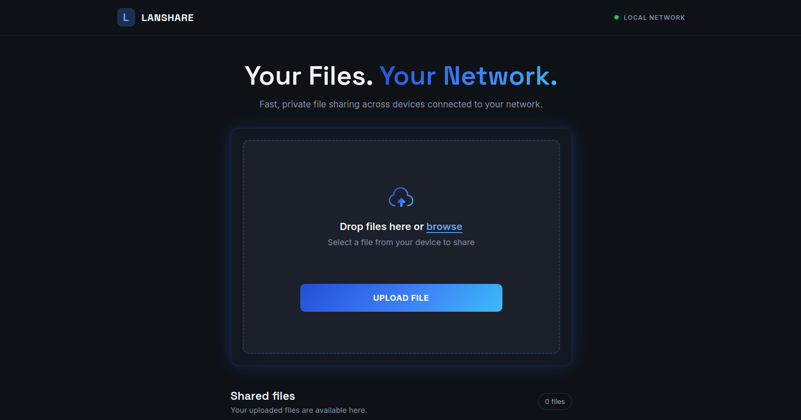

# LANSHARE

A small Flask based application that enables users on the same wireless network to share files.

As well as being able to upload and view shared files, this application can also produce a QR code which makes it quicker to connect to.

I aimed to create a useful application, and to explore how web applications can upload, download and interact with each other on a network, all in Python.

## Here's how it looks



## How I created it

For the application I used Python, alongside HTML, CSS and JavaScript.

- [Flask](https://github.com/pallets/flask) – for managing routes and files
- HTML – to define the web app layout
- CSS – to format the web app
- JavaScript – for uploading files and updating the app
- [qrcode](https://github.com/lincolnloop/python-qrcode) – for producing QR codes and allowing users to connect to the web app via a network

## What it can do

- Upload files from another computer on the same wireless network
- Download shared files
- Remove files from the shared folder
- Upload several files at once
- Upload files using drag and drop
- Show files along with their file size
- Prevent new files from replacing already shared files of the same name
- Produce a QR code enabling people to connect to the web app via a network
- Automatically find a computer's local IP address
- Provide information regarding file uploads and basic error information

## Want to test it?

Python 3 and pip must be installed on your computer.

**1. Clone the repo**

```bash
git clone https://github.com/Developer-Gaurav96/LANSHARE.git
cd LANSHARE
```

**2. Set up a virtual environment**

```bash
python -m venv .venv
```

**3. And then activate it**

Linux and macOS:

```bash
source .venv/bin/activate
```

Windows:

```powershell
.venv\Scripts\activate
```

**4. Install the relevant libraries**

```bash
pip install Flask "qrcode[pil]"
```

**5. Start LANSHARE**

```bash
python app.py
```

Then, on another computer also on the same wireless network, view the local network URL shown in your preferred internet browser.

Both computers should be on the same local network.

## What I learnt

Creating this web app allowed me to further my knowledge on how Flask manages HTTP requests, and to see how files are uploaded and stored on servers. I additionally learnt how computers can interact on a local network.

Throughout this project I also had the opportunity to utilise HTML forms, JavaScript's Fetch API, file management, and QR code production. I was also able to implement live updating within a web application.

Although there were some issues to resolve whilst producing this web app, identifying and analysing these was a key element of the process.

## AI Note

I used ChatGPT to aid me in identifying, analysing and resolving issues. Furthermore, I also used it to carry out code assessments and to help me to comprehend and improve my code. Despite this, I produced and altered the code myself, basing my actions on the advice I had received from the AI.

---

Still learning, still creating! :D
